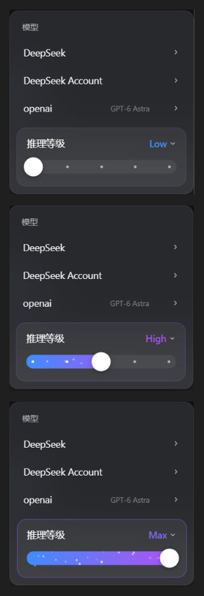

# better-dsh-codex-effort-slider

> 给 [DeepSeek Harness](https://github.com/deepseek-ai/deepseek-harness)（DSH）用的 **Codex 风格推理等级滑条**：
> 把输入框那颗模型席按钮换成一条可拖动的连续滑条 —— 一档一色、越往右越"通电"，高档位亮起紫色星云与星尘。
>
> *A Codex-style reasoning-effort slider for DeepSeek Harness. Continuous drag, per-level colors, particle
> effects that intensify with effort, light/dark aware.*




浅色主题同样可读（档位文字对比度算过：白底 4.23:1、深色底 4.02:1）：
[`preview/value-color-light.png`](preview/value-color-light.png)。
两张图都是**真机截图**（在 DSH Desktop 里逐个档位截下来再拼接），不是渲染稿。

---

## 目录

- [特性](#特性)
- [安装](#安装)
- [使用](#使用)
- [配置](#配置)
- [兼容性](#兼容性)
- [常见问题](#常见问题)
- [已知限制](#已知限制)
- [开发](#开发)
- [打包与发布](#打包与发布)
- [项目结构](#项目结构)
- [文档](#文档)
- [致谢与许可](#致谢与许可)

---

## 特性

- **一条连续的滑条**，不是几个离散按钮：拖动即改档位，颜色与粒子**由位置连续驱动**，与模型有几档无关。
- **一档一色**：填充层从蓝渐变到紫罗兰，右端是当前位置的颜色；官方那一行的数值文字也跟着变色
  （`Off` 档保持官方灰）。
- **越往右越"通电"**：高档位亮起紫色星云与星尘粒子，粒子数与横穿速度随位置变化。
- **接管官方模型席，不并排**：输入区仍然只有一颗 `模型名 · 档位名 ⌄`，点开是自建的两级面板
  （provider 列表 → 模型列表 + 搜索），**点模型不关面板**、滑条立刻跟到新模型的档位。
- **换模型默认落在中间档**：总档数为偶数时取"中间的下一个"（4 档 → 第 3 档）。
- **深浅主题自适应**：面板用官方菜单那套毛玻璃材料（`blur(40px) saturate(150%)`）+ 半透明底 + 阴影；
  星尘与旋钮是固定浅色（它们永远落在蓝紫填充层上）。
- **失败可读、fail-open**：读不到目录、宿主没列 provider、加载失败 —— 面板都会写出**原因原文**
  （含宿主逐 provider 的报错）；任何一步认不出就退回"什么都不做"，绝不把官方界面改坏。
- **零运行时依赖**，离线断言 **911** 项。

---

## 安装

> 不想 clone：直接下载本仓库 [Releases](https://github.com/Bai-2008/a-better-dsh-codex-effort-slider/releases)
> 里打包好的 zip（`better-dsh-codex-effort-slider-<version>.zip`）。

三种方式，按省事程度排序：

### 1. 插件面板（推荐）

DSH Desktop → **设置 → 插件 → 添加插件**，填三者之一：

- **本地目录路径**（clone 或解开 zip 后那一层目录）
- **`github:Bai-2008/a-better-dsh-codex-effort-slider`**
- **npm 包名**（走 registry）

安装后**完全退出并重开 DSH Desktop**（宿主在启动时把插件读进内存，只关窗口不够）。

### 2. 一键脚本

当设置里没有「插件」面板时（`dsh-base` 会把 `plugin-manager` 整行 disabled）：

```powershell
install.cmd                    # 装进 desktop profile
install.cmd -Profile tui       # 装进别的 profile
install.cmd -Uninstall         # 卸载
```

`install-profile.ps1` 做四件事：备份 profile 的 `package.json` → 加一条 `link:` 依赖 →
把包名追加进 `dsh.profile.bundles` → 在 profile 的 `node_modules` 下建链接（Windows 用 junction），
最后校验这三项都成立。已用假 profile 完整跑过安装与卸载，并确认卸载只删链接。

### 3. 命令行（**只有非 desktop profile 能这么装**）

```powershell
dsh plugin --profile tui add link:"<插件的绝对路径>"
dsh plugin --profile tui add github:Bai-2008/a-better-dsh-codex-effort-slider
```

`desktop` 是 Electron 保留 profile，命令行会被直接拒绝：

```
error: profile "desktop" is managed exclusively by the Electron application
```

### 升级与卸载

- **升级**：面板里重装 / 重新指向新目录，然后**完全退出并重开** DSH Desktop。
- **卸载**：面板卸载，或 `install.cmd -Uninstall`；手工建过 junction 的用
  `cmd /c rmdir <junction>`。
  ⚠️ **不要**用 `Remove-Item -Recurse`，它可能顺着链接把插件目录里的文件删掉。

---

## 使用

**收起态**（输入框右侧，就一颗按钮）：

```
[ DeepSeek-V41-Flash  Max  ⌄ ]
```

**点开**是两级面板：

| 操作 | 结果 |
|---|---|
| 点 provider 行 | 面板横向翻页到该 provider 的模型列表（带搜索框） |
| 点某个模型 | **只切模型**、不关面板；滑条立刻跟到新模型，落在**中间档**（奇数档取正中，偶数档取中间的下一个） |
| 拖滑条 / 点轨道 | 改档位。拖动期间不写宿主，**松手或停手 260ms 后落地**一次 |
| 点档位名（`Max ⌄`） | 展开档位弹层：每行 = 档位名 + 原始 API 取值（`max`） |
| `Esc` | 逐层退避：弹层 → 二级页 → 关闭面板 |
| 点面板外 / 点按钮 | 关闭面板 |

细节：面板**右缘与输入框右缘对齐**、底边贴按钮上方 8px；页面滚动或窗口缩放时**只重新定位、不关闭**
（助手流式输出时聊天区会一直自动滚动）；助手运行期间宿主会藏起控件行，此时面板保持原位。

---

## 配置

插件是**编译期配置**（没有运行时设置界面），常量都在源码里、改完重新构建 + 重启：

| 常量 | 位置 | 作用 |
|---|---|---|
| `ENABLE_OFFICIAL_MENU_SLIDER` | `lib/client.js` | `false`（默认）= 自建浮层接管官方席；`true` = 回到"改造官方菜单那一行"的老路（两套互斥） |
| `STARFIELD_DURATION_SPREAD` | `lib/client.js` | 星尘时长浮动，默认 `±8%`；设成 `0` 则所有星完全同速（永不聚集，但没有快慢层次） |
| `TRACK_HEIGHT` / `KNOB_SIZE` | `lib/client.js` | 轨道高与旋钮直径，默认 `28px`（正圆 = 轨道高） |
| `COLOR_TEXT_VIOLET` 等色值 | `lib/client.js` | 档位文字/填充的终点色，改之前先看 `ARCHITECTURE.md` 里的对比度约束 |

面板材料（模糊、底色、阴影）在 `lib/client.picker.src.js` 的 `GLASS_VARS` 里 —— 想更透/更实就改那两个 alpha。

---

## 兼容性

| 项 | 说明 |
|---|---|
| DSH | 已在 **DSH Desktop 0.2.0-rc.2（Windows）** 实机验证；需要客户端提供 `slots` / `sessions` / `remote` / `remote.session` / `modelDirectories` 五个服务，以及 `conversation.input.model`、`conversation.input.overlay`、`conversation.input.right` 三个槽 |
| 平台 | Windows 实机验证；安装脚本对其它平台用符号链接代替 junction |
| 主题 | 跟随 DSH 主题（`body[data-ds-dark-theme]`），令牌缺失时回退到中性灰 + `#4d93f8` 蓝 |
| 运行时依赖 | 无 |
| Node | `>= 22`（**仅开发/构建需要**，插件本身跑在宿主里） |

---

## 常见问题

**装完没反应？**
先**完全退出并重开** DSH Desktop（不是关窗口）。还不行 → **设置 → 插件** 点开插件详情，
那行有没有 `error`：宿主读 `package.json` 是直接 `JSON.parse`，清单有问题（例如 BOM）会让整包被丢弃，
界面毫无反应的根因就在那里。

**面板说「宿主没有列出任何 provider」？**
这句说明**宿主的模型目录是空的** —— 不是插件的问题：官方 `/model` 命令此刻同样是空的。
去 DSH 的**设置 → 模型 / 账号**看：通常是没有可用 provider，或账号 provider 拿不到令牌
（端点与账号登录不匹配时会**静默返回空列表**）。

**面板说「会话目录未就绪，正在重试…」，下面还有一行字？**
那行就是**宿主的原话**（例如 `ui-model-selection: session "…" resolved no scope`）。它内含是哪个会话 id，
把这行发出来即可定位；插件会自己退避重试 + 心跳自愈，通常几秒内恢复。

**面板说「还没有会话 —— 发一条消息后就能选模型」？**
你正停在"新会话"的空白壳上，输入区此时还没有会话 id。发一条消息、或打开一个已有会话即可。

**改了源码 / 换了版本，界面还是旧的？**
宿主给客户端 chunk 的 URL 带 `?rev=`，而这个 `rev` 是按 `lib/client.js` 的 mtime/size 算的，
响应头还是 `immutable`。**只改 picker 不会让 rev 变**，浏览器会拿一年缓存的旧 chunk。
解法：`Ctrl+Shift+R` 硬刷新（或重启 DSH），或让时间戳动一下：

```powershell
(Get-Item lib/client.js).LastWriteTime = Get-Date
```

**为什么只有一颗按钮？**
官方那颗席按钮和自建按钮都是 `conversation.input.model`（single 槽）的占用者：
插件用 `priority: -1` **遮蔽**官方那颗，所以不会并排出现两颗。代价见「已知限制」。

---

## 已知限制

- **需要重启 DSH Desktop 才生效**（客户端 bundle 在启动时注入）。
- **官方模型菜单没有入口了**：那颗席按钮是官方菜单（模型列表 / 档位列表 / 键盘导航 / aria）的唯一入口，
  被接管之后就打不开了。切模型仍有两条路 —— 本插件的面板，以及官方的 **`/model` 命令**。
  想回退成"官方菜单 + 里面长滑条"，把 `ENABLE_OFFICIAL_MENU_SLIDER` 改成 `true`。
- **依赖官方语义锚点**（`aria-haspopup` / `aria-expanded` / `aria-controls` / `role`，不依赖哈希 class）。
  官方若改成非 `menuitem` 结构或不再用 `data-composer-card`，插件**静默退回"什么都不做"**（fail-open）。
- **模型列表与档位来自宿主目录**：目录没列到的模型，面板里也就看不到；徽标的"几档"同样以目录为准
  （目录还没列到、又不在本地兜底清单里时，宁可不显示徽标）。
- **模型列表的"新 → 旧"是启发式的**：宿主目录不带发布日期，顺序由 id / 显示名里的版本号与日期算出；
  名字里完全看不出新旧的模型一律沉底并保持宿主原顺序。只排自建面板那一屏（官方菜单里的顺序不动）。
- **8 档模型只有末档满能量**这条观感与参考实现不同：本插件是连续曲线（8 档 `Max` = 11/14），
  见 [MODIFICATIONS.md](MODIFICATIONS.md) 第七节第 4 条，是有意取舍。
- 老路 A（`ENABLE_OFFICIAL_MENU_SLIDER = true`）会给官方那一行加高约 20px + 滑条 28px，
  极小屏幕上可能出现菜单贴边（官方自身的 `max-height` 与夹取逻辑仍在）。

---

## 开发

```powershell
npm run build     # lib/client.picker.src.js → lib/client.picker.js（幂等；生成物别手改）
npm test          # 离线断言套件（911 项；pretest 会自动先 build）
npm run preview   # 生成 preview/panel.html（浏览器打开即可拖、切深浅色、切 4/2/6 档）
```

包本身**零依赖**，不需要 `npm install`：上面三条脚本都只是 `node xxx.mjs` 的包装，
直接 `node build/pack-picker.mjs` / `node test/client.test.mjs` / `node preview/make-preview.mjs` 等价。

源码是**三层**：`lib/client.js`（手写接线 + DOM 桥）、`lib/client.picker.src.js`（自建浮层，需构建）、
`lib/index.js`（宿主侧一行）。改完 picker 记得 `npm run build`，并注意上面那条 **chunk 缓存 rev** 的坑。

预览页支持几个给无头截图用的参数（README 里那两张 `preview/value-color-*.png` 就是这么生成的）：
`?level=<档位 id>` 定位到某一档、`?dark=1` 进深色、`?shot=1` 只留「模型 + 推理等级 + 滑条」两行。
例：`preview/panel.html?shot=1&level=max`。

实现细节（两套 UI、接管时序、DOM 锚点、色彩与粒子数学、旋钮几何、稳健性清单、测试台策略）
都在 **[ARCHITECTURE.md](ARCHITECTURE.md)**。

---

## 打包与发布

```powershell
npm run pack        # 运行时包：dist/better-dsh-codex-effort-slider-<version>.zip
npm run pack:src    # 源码包：…-<version>-src.zip
```

| 包 | 内容 | 用途 |
|---|---|---|
| 运行时包（5 个文件） | `package.json`、`cordis.patch.yml`、`lib/index.js`、`lib/client.js`、`lib/client.picker.js` | 安装 / 升级。零依赖，解开就能装 |
| 源码包（18 个文件） | 上面这些 + `lib/client.picker.src.js`、`build/`、`test/`、`preview/`、文档与安装脚本 | 读源码 / 自己改 / 自己验证 |

源码包是**自足**的：解开后 `npm run build` 可重现同一份 chunk，`npm test` 直接跑完整套断言。
两个 zip 与 `SHA256SUMS.txt` 都落在 `dist/`（已 gitignore），是给 GitHub Releases 用的附件。

> 想发到 npm 的话：`package.json` 里现在是 `"private": true`，需要先删掉这一行。

---

## 项目结构

```
lib/
  index.js              宿主侧插件（让本包成为 cordis 树上的一行）
  client.js             客户端接线 + DOM 桥 + 官方菜单那行的滑条（手写产物）
  client.picker.src.js  自建浮层源码（滑条面板）
  client.picker.js      上面那个的构建产物（包内 chunk，别手改）
build/pack-picker.mjs   把 picker 源码包成自注册 chunk
test/
  client.test.mjs       离线断言套件（911 项）
  harness.mjs           保状态 React 桩 + 假 DOM + 假官方菜单
preview/
  make-preview.mjs      生成 preview/panel.html（观感预览页）
  *.png                 文档里的效果图
install.cmd             profile 安装脚本入口（desktop profile 的兜底）
pack-dist.ps1           打发布 zip
cordis.patch.yml        bundle 补丁层（声明本插件在组合里的一行）
```

---

## 文档

| 文档 | 内容 |
|---|---|
| [ARCHITECTURE.md](ARCHITECTURE.md) | 怎么实现的：两套 UI、接管时序、DOM 锚点、数据路径、色彩/粒子数学、稳健性清单、测试台 |
| [INCIDENTS.md](INCIDENTS.md) | **真机事故复盘**（九条）：现场 → 根因 → 修法 → 断言。装不上/界面不对时先翻这份 |
| [CHANGELOG.md](CHANGELOG.md) | 逐版改动流水 |
| [MODIFICATIONS.md](MODIFICATIONS.md) | 相对上游的主题式改动清单、移植对照与取舍 |

---

## 致谢与许可

- 本仓库是 [Microqian2th/dsh-codex-effort-slider](https://github.com/Microqian2th/dsh-codex-effort-slider)
  （`1.0.0`）的**修改分支**：滑条观感、连续能量曲线、自建浮层与后续修复都在这里。
- 目标宿主是 [deepseek-ai/deepseek-harness](https://github.com/deepseek-ai/deepseek-harness)，
  本插件只使用它的公开面（槽位、`modelDirectories` 服务与语义 DOM 锚点）。
- 许可 **MIT**（见 [LICENSE](LICENSE)）。无可选第三方代码：闪电标 / 雪弗龙是自己画的路径，
  粒子层是自己写的 DOM/CSS。
